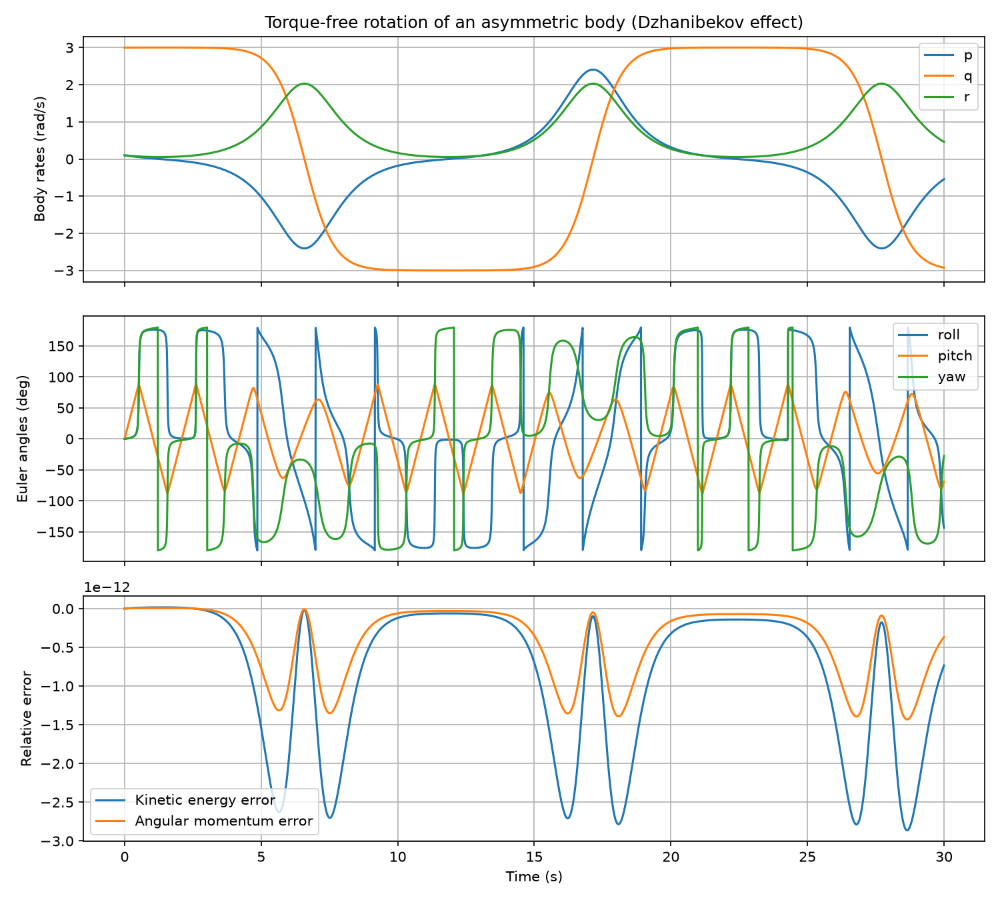
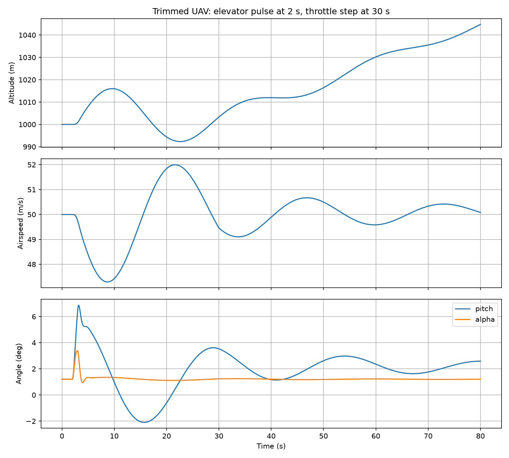
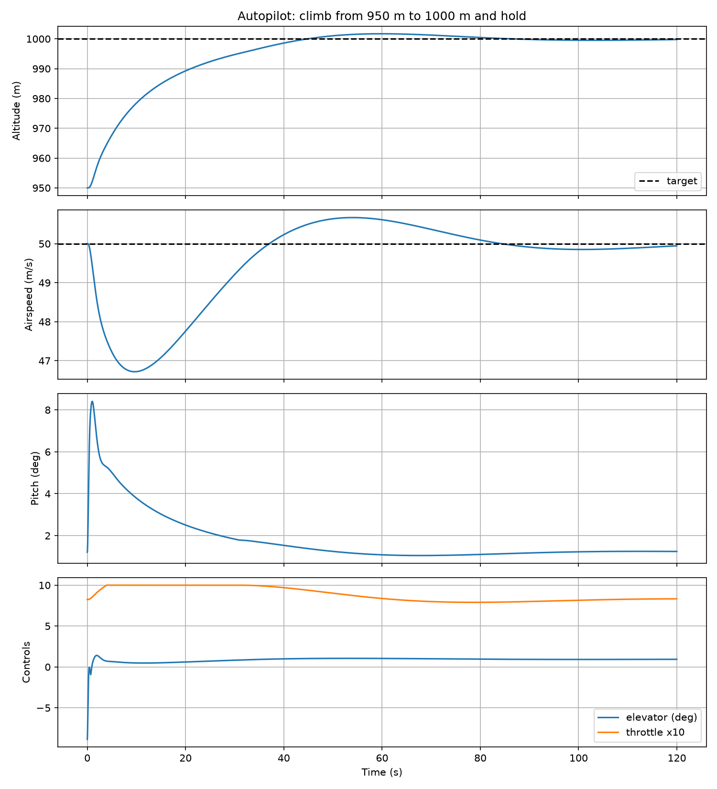
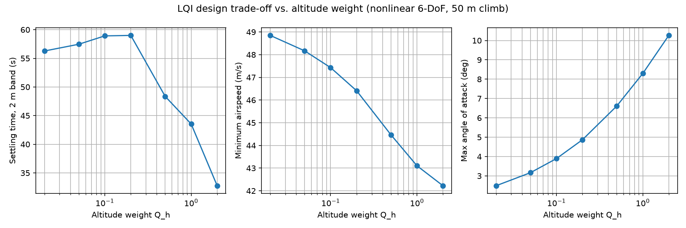
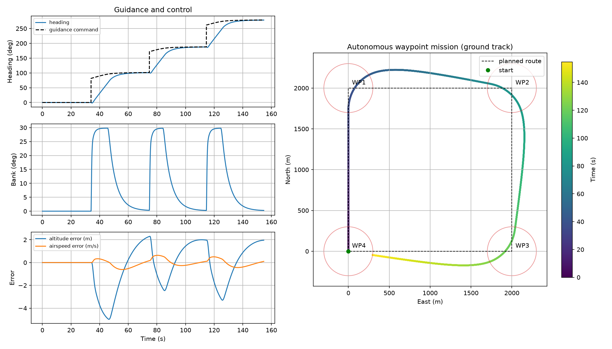
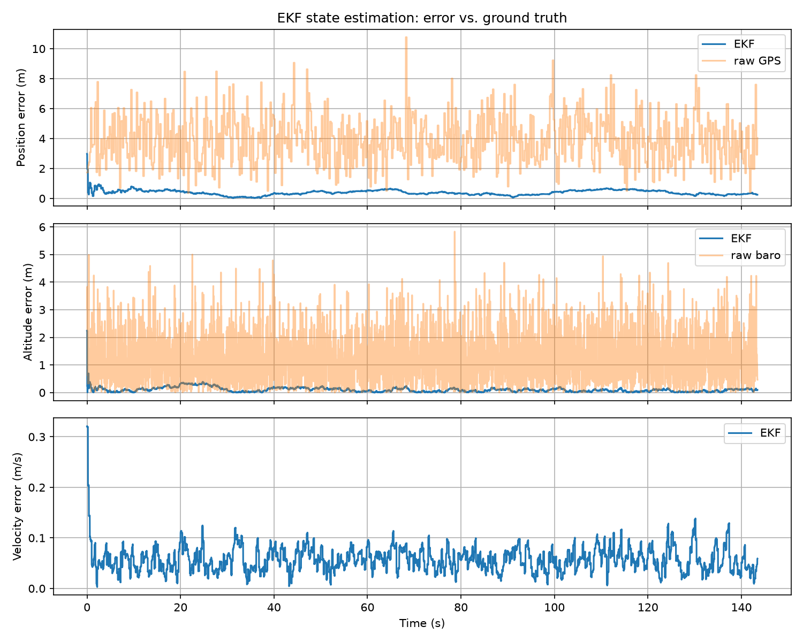

# uav-6dof-autopilot

[](https://github.com/SirPicklee/uav-6dof-autopilot/actions/workflows/tests.yml)


A 6-DoF fixed-wing UAV flight dynamics simulator with a PID autopilot, written in Python.
Built from first principles: quaternion kinematics, RK4 integration, ISA atmosphere,
aerodynamic force/moment model, trim solver, and closed-loop altitude/airspeed hold.

> **Disclaimer:** The aircraft is a *TB2-class representative UAV*. Span, wing area and mass
> are in the range of open-source figures; aerodynamic coefficients are **estimated**.
> They are not official manufacturer data.

## Features

- Quaternion attitude library (Hamilton convention, body -> NED)
- Fixed-step Euler and RK4 integrators with post-step hook and stop conditions
- International Standard Atmosphere model (0-20 km, with temperature offset)
- Aerodynamic model: lift with stall saturation, drag polar, side force, roll/pitch/yaw moments, propeller thrust
- 13-state 6-DoF equations of motion with wind input
- Level-flight trim solver (alpha, elevator, throttle)
- PID controller with derivative-on-measurement, derivative filtering and anti-windup
- Altitude-hold and airspeed-hold autopilot (cascaded loops)
- Linearization and modal analysis (short period, phugoid, Dutch roll, roll, spiral)
- LQR and LQI longitudinal controllers, compared with PID in the nonlinear model
- Lateral autopilot (heading hold, yaw damper) and waypoint guidance (radius capture, L1 leg following)
- IMU, GPS and barometer sensor models and a 9-state EKF
- 82 unit tests, GitHub Actions CI

## Validation

| Check | Result |
|---|---|
| Torque-free rotation, kinetic energy drift (30 s) | ~7e-13 |
| Torque-free rotation, angular momentum drift (30 s) | ~4e-13 |
| RK4 convergence order (harmonic oscillator) | ~4 |
| ISA atmosphere vs. standard table values | within 0.1% |
| Trim: thrust vs. drag balance at 50 m/s, 1000 m | converged |
| Autopilot: 50 m climb step, overshoot | 0.6 m (1.2%) |
| Autopilot: final altitude error after 120 s | -0.06 m |

### Torque-free rotation (Dzhanibekov effect)



### Open-loop response: short period and phugoid



### Closed-loop altitude hold



## Installation

```bash
git clone https://github.com/SirPicklee/uav-6dof-autopilot.git
cd uav-6dof-autopilot
python -m venv venv
venv\Scripts\activate        # Windows
# source venv/bin/activate   # macOS / Linux
pip install -r requirements.txt
```

## Usage

Run the tests:

```bash
python -m pytest
```

Run the examples (Windows PowerShell):

```powershell
$env:PYTHONPATH="src"
python examples\torque_free_rotation.py
python examples\first_flight.py
python examples\autopilot_climb.py
```

## Project structure

## Roadmap

- [x] Wind rejection (airspeed feedback, PID integral separation); turbulence not yet tested
- [x] Linearization and modal analysis (short period, phugoid, Dutch roll)
- [x] LQR/LQI controller and comparison with PID
- [x] Sensor models and EKF (IMU + GPS + barometer), with ground-truth attitude
- [x] Waypoint navigation and lateral autopilot
- [ ] Attitude estimation (complementary / Mahony filter) feeding the EKF
- [ ] Actuator dynamics (servo lag, rate limits)
- [ ] Cross-validation against JSBSim / PX4 SITL
- [x] GitHub Actions CI
- [ ] C++ core

## License

MIT


## PID vs. LQI (nonlinear 6-DoF, 50 m climb)

Both controllers start 50 m below the target at trim airspeed (50 m/s, 1000 m) and are
evaluated in the full nonlinear model. The LQI is a longitudinal LQR augmented with an
airspeed integrator (the altitude state is the altitude error itself, not its integral).
Weights: `Q = diag(0.1, 1, 1, 10, Q_h, 0.5)`, `R = diag(100, 1)`.

| Controller | Settling (2 m) | Min airspeed | Max alpha |
|---|---|---|---|
| PID (`ki = 0`) | 39.9 s | 46.7 m/s | 4.65 deg |
| LQI, Q_h = 0.02 | 56.3 s | 48.8 m/s | 2.49 deg |
| LQI, Q_h = 0.05 | 57.5 s | 48.2 m/s | 3.16 deg |
| LQI, Q_h = 0.10 | 58.9 s | 47.4 m/s | 3.89 deg |
| LQI, Q_h = 0.20 | 59.0 s | 46.4 m/s | 4.87 deg |
| LQI, Q_h = 0.50 | 48.4 s | 44.5 m/s | 6.61 deg |
| LQI, Q_h = 1.00 | 43.5 s | 43.1 m/s | 8.30 deg |
| LQI, Q_h = 2.00 | 32.8 s | 42.2 m/s | 10.26 deg |



**Finding:** in this scenario and with these weights, PID gives a better trade-off than LQI.
LQI with a similar speed dip and alpha (Q_h = 0.2) is much slower (59 s); LQI with a similar
settling time (Q_h = 1.0) has a deeper speed dip and higher alpha. This is not a general
statement about LQR: R, the other Q entries and the altitude-error clipping (10 m) were not
explored systematically. Settling time is not monotonic in Q_h for small weights; the cause
was not investigated.

Linear analysis at trim (50 m/s, 1000 m): phugoid period 26.2 s (zeta 0.10), short period
wn 3.85 rad/s (zeta 0.52), Dutch roll wn 3.0 rad/s (zeta 0.26), roll mode tau 0.12 s,
spiral tau 69 s (stable). The simulated phugoid period matches the eigenvalue analysis.

## Wind rejection

Wind steps on at t = 10 s while the UAV is trimmed at 50 m/s, 1000 m. Controllers use
**airspeed** (ground velocity minus wind) as the speed feedback. PID here is the current
tuning: `ki = 0.0002` with integral separation (`i_zone = 5 m`).

| Case | Controller | Max altitude error | Final altitude error | Airspeed |
|---|---|---|---|---|
| Downdraft 0.5 m/s | PID | 2.04 m | -0.107 m | 49.97 m/s |
| Downdraft 0.5 m/s | LQI | 0.91 m | -0.884 m | 50.00 m/s |
| North wind 5 m/s | PID | 2.55 m | 0.017 m | 50.02 m/s |
| North wind 5 m/s | LQI | 7.50 m | -1.662 m | 50.00 m/s |
| Downdraft 2 m/s | PID (`ki = 0`) | 19.0 m | -19.0 m | 45.3 m/s |
| Downdraft 2 m/s | LQI | 114.7 m | -114.7 m | 50.0 m/s |

Notes:

- The 2 m/s downdraft may exceed the available thrust margin at 50 m/s. This was not
  measured; the rows are reported as they came out.
- The LQI altitude state is a proportional term (altitude error), not an integral, so it
  leaves a steady-state altitude error under a constant downdraft.
- LQI `u` and `w` states still come from ground-relative body velocity; only its speed
  integrator uses airspeed. Whether this explains the larger error in the north-wind case
  was not tested.

## Issues found during validation

1. **Ground-speed feedback.** The first wind test fed ground speed to the controllers. With a
   5 m/s north wind, airspeed settled at 45 m/s while ground speed read 50 m/s. Fixed by
   feeding airspeed to the speed loops.
2. **Integral action vs. climb overshoot.** PID with `ki = 0.0002` overshot a 50 m climb by
   10.5 m. With `ki = 0` the overshoot was 0.6 m but a 0.5 m/s downdraft left a 2.5 m steady
   error. Integral separation (integrate only while |error| < 5 m) gives 1.7 m overshoot and
   a -0.107 m steady error.
3. **Wrong hypotheses about LQI slowness.** Raising the altitude-error clip from 10 m to 25 m
   and removing the speed-integrator clamp did not shorten settling time. Raising the
   altitude weight did, at the cost of a deeper speed dip and higher alpha.
4. **LQR short-period bandwidth.** The first LQR placed the short period near 15 rad/s, which
   is unrealistic without actuator dynamics. Increasing R brought it to about 8.5 rad/s.

## Known limitations

- Aerodynamic coefficients are estimated, not manufacturer data.
- No actuator dynamics (no servo lag or rate limits).
- No sensor noise or state estimation yet (EKF is on the roadmap).
- Longitudinal control only; no lateral autopilot yet.

## Lateral autopilot and waypoint navigation

The lateral autopilot is cascaded: heading error -> bank command (P, limited to 30 deg),
bank error -> aileron (PID), plus a washout yaw damper on the rudder. It runs together with
the longitudinal altitude/airspeed hold in the nonlinear 6-DoF model.

**Heading steps (four 90 deg steps, square pattern):** settling to within 2 deg took about
22 s each, with 0.00 deg overshoot. Max bank 29.8 deg, max sideslip 4.03 deg (when it occurs
was not examined), altitude 995.1 to 1002.2 m, airspeed 49.4 to 50.7 m/s during the turns.

### Autonomous waypoint mission

Closed square, 2 km legs, 1000 m, 50 m/s, four waypoints. Mission completed in about
143 to 155 s depending on the guidance law. During the mission altitude stayed within
995.0 to 1002.3 m and airspeed within 49.4 to 50.6 m/s (radius capture run).

Two guidance laws are compared:

- **Radius capture:** fly directly toward the active waypoint, switch when within 300 m.
- **L1 leg following:** aim at a point 400 m ahead on the current leg, switch legs 441 m
  before the waypoint (about the turn radius at 30 deg bank).

| | Radius capture | L1 leg following |
|---|---|---|
| Mission time | 154.7 s | 143.4 s |
| Closest approach to WP1-3 | 64 to 66 m | 145 to 154 m |
| Max cross-track, leg 2 | 184.2 m | 33.7 m |
| Max cross-track, leg 3 | 128.1 m | 36.0 m |
| Max cross-track, leg 4 | 143.6 m | 35.4 m |

Notes on these numbers:

- Cross-track is the maximum deviation in the second half of each leg, up to the leg switch.
  It indicates how well the aircraft settles on the line after a turn; it is not an upper
  bound on path error. Whether the turn is finished by mid-leg was not checked.
- L1 tracks the line much more closely after turns, but passes 145 to 154 m from the
  waypoints because it starts turning early. If a mission requires flying over the waypoint,
  this is a cost.
- The leg 1 value (0 m) and the WP4 closest approach are omitted: WP4 coincides with the
  start point, so those numbers carry no information.
- An earlier cross-track measurement was invalid (it mixed points from other legs and the
  window start) and was discarded. `turn_lead` and `L1` distance were chosen by estimate and
  not tuned.



## State estimation (EKF)

A 9-state extended Kalman filter estimates position (NED), velocity (NED) and accelerometer
bias. It predicts at 100 Hz from IMU specific force and corrects with GPS (5 Hz, position and
velocity) and a barometer (25 Hz, altitude). Covariance is updated in Joseph form.

Sensor models (white noise, plus random-walk bias for the IMU) use **estimated** noise levels
representative of small UAV sensors, not values from a specific datasheet: GPS 2.5 m position
and 0.1 m/s velocity, barometer 1.5 m, accelerometer 0.05 m/s^2, gyro 0.002 rad/s.

Scenario: closed-square mission with L1 guidance (about 143 s), first 10 s excluded from RMS.

| Quantity | EKF RMS error | Raw sensor |
|---|---|---|
| Position | 0.40 m | 4.26 m (GPS, measured) |
| Altitude | 0.13 m | 1.51 m (barometer, measured) |
| Velocity | 0.061 m/s | about 0.173 m/s (GPS, theoretical) |



**These results are optimistic.** Attitude is supplied to the filter as ground truth, the filter
noise parameters equal the true sensor noise, the IMU has no scale-factor error, misalignment or
vibration, and filter consistency (covariance vs. actual error) was not checked.

### Sensitivity to attitude error

A constant roll error was added to the attitude given to the EKF (simulation unchanged):

| Roll error | Position RMS | Velocity RMS | Max position error |
|---|---|---|---|
| 0 deg | 0.40 m | 0.061 m/s | 0.68 m |
| 1 deg | 0.43 m | 0.148 m/s | 0.73 m |
| 3 deg | 0.51 m | 0.414 m/s | 0.85 m |
| 10 deg | 0.86 m | 1.356 m/s | 1.43 m |

Velocity is much more sensitive to attitude error than position: 1 deg raises velocity RMS
about 2.4x, position only about 8%. A likely reason is that GPS position corrections bound the
drift, and that the filter absorbs part of the error into the accelerometer bias estimate, but
neither mechanism was measured. Only constant roll error was tested (no pitch, yaw or
time-varying error), and flight and turns were not analysed separately.


